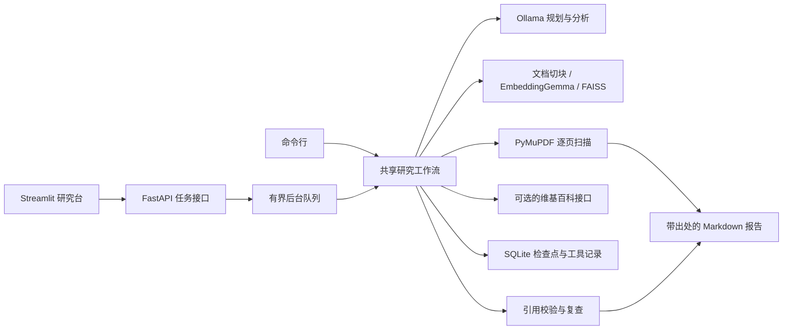

# Evidence-Grounded Research Orchestrator

**面向证据的本地研究 Agent，支持工具编排、任务恢复与引用追溯。** 从研究问题或上传论文出发，拆解任务、收集证据、核对引用，最后生成带页码、行号或网页修订版本的 Markdown 报告。基于 Python、Ollama、SQLite、FastAPI 和 Streamlit，自行实现模型适配、工具注册、任务调度和证据处理。

| 使用场景 | 系统行为 |
|---|---|
| 针对资料提问 | Ollama 生成任务计划，按依赖执行，结合本地检索与可选的维基百科资料。保留有证据支持的结论，在报告中列出证据缺口。 |
| 提取论文目录 | 对数字 PDF 逐页扫描，保留识别出的章节层级、页码范围与原文要点。 |
| 追踪和恢复任务 | 查看子任务、尝试次数、工具日志与历史报告，进程中断后可从 SQLite 检查点继续执行。 |

[架构](#架构) · [实现过程](#从模型接入到应用交付) · [调试与回归](#真实输入怎样改变了设计) · [两篇论文最终结果](#两篇论文的最终验收结果)

## 架构



### 模型接口与工具执行

- `BaseLLM` 与 `OllamaLLM` 统一消息、流式响应、结构化输出、工具请求和 Token 统计。上层可以用测试替身复现超时、断流和无效响应。
- `ToolRegistry` 将工具参数声明转换为 JSON Schema，并在分发前按同一声明校验实参，返回统一结果与错误码。计算器只接受允许的算术 AST 节点，文件读取限定在授权目录。
- 通用 Agent Loop 会将工具结果回传给模型，并在模型请求数、工具调用数或时间预算耗尽时停止。真实示例完成了「读文件 → 计算 → 返回 137」，共三轮模型调用。研究工作流由程序控制取证和校验，模型参与规划与分析。 [模型接口](src/research_agent/llm/base.py) · [工具注册表](src/research_agent/tools/registry.py) · [Agent Loop](src/research_agent/agent/engine.py)

### 计划、状态与故障恢复

模型输出结构化计划，程序校验任务依赖和优先级。执行失败时按预算重试，前置任务失败会阻塞依赖它的步骤。每次尝试先写检查点，中间结果和相关消息可在同一事务保存。同一研究任务由进程锁保护，恢复时跳过已经结束的步骤。项目用实际进程退出、再启动的方式验证了恢复流程。 [计划与调度](src/research_agent/agent/planning.py) · [执行器](src/research_agent/agent/executor.py) · [持久化与恢复测试](tests/test_memory.py)

### 文档证据与引用

普通问答用 PyMuPDF 解析数字 PDF，并支持 TXT、Markdown。切块保留物理页码或行号，EmbeddingGemma 生成向量，CPU FAISS 按相似度找候选。日志记录候选位置、分数和过滤后保留的数量。模型为每条结论选择原文摘录编号，程序回填引述及定位信息，再发起一次模型请求复查证据支持度。报告会标注证据缺口、被拒结论和单一来源。

「列出全部章节」这类目标需要检查全文覆盖。目录流程会遍历 PDF 页面，识别可见标题的层级与起止页，并从章节范围内挑选原文要点。这条路径可以在嵌入服务关闭时运行。 [文档处理](src/research_agent/rag/documents.py) · [目录提取](src/research_agent/research/outline.py) · [引用校验](src/research_agent/research/report.py)

### 应用边界

FastAPI 提供上传、提交、状态、历史、恢复和报告下载。Streamlit 的「沿用已上传资料」与「把上一轮问题作为背景」是独立选项。应用默认绑定本机环回地址，使用单工作线程和有界队列。上传文件、工具请求和模型响应都有大小或次数限制，外部资料无法授予工具权限。联网研究需要显式启用，目前提供方为英文维基百科。 [接口约定](docs/application.md) · [权限与预算](docs/security.md)

## 从模型接入到应用交付

| 阶段 | 解决的问题与实现细节 | 可核查的验证 |
|---|---|---|
| **0–1 · 项目与环境** | 从 Ollama 调用脚本建立 Git 基线，用 `pyproject.toml`、Python 3.12 虚拟环境、环境变量与可编辑安装固定入口。 | `doctor` 验证本地服务及模型，`pip check` 检查依赖。 |
| **2–3 · 模型协议与抽象** | 先打通 HTTP、JSON 和 NDJSON 流，再定义 `BaseLLM`、Ollama 适配器及统一消息。把 HTTP 错误、超时、无效消息和断流映射为可测试的异常。 | 真实模型完成 6 项能力验证。协议层使用模拟响应复现边界错误。 |
| **4–6 · 工具调用与 Agent Loop** | 模型生成工具名和参数。注册表验证并执行，工具结果以 `tool` 消息回传。循环跟踪模型步数、工具次数与截止时间。 | 真实演示三轮完成 `read_file → calculator → 137`，并覆盖无效参数、工具失败与预算退出。 |
| **7–8 · 任务编排与恢复** | 结构化计划定义子任务、依赖与优先级。执行器处理重试和失败传播。SQLite 保存检查点、资料与中间消息，进程锁约束同一任务的并发恢复。 | 实际终止执行进程，再启动进程验证已完成步骤跳过、剩余步骤读取前置结果后继续。 |
| **9–10 · 检索与证据报告** | 按页或行号提取资料，切块后用 EmbeddingGemma 建立向量，通过 CPU FAISS 召回候选。可选维基百科提供网页资料。报告先核对摘录 ID 与出处，再复查结论。 | 三条固定查询 Top 1 均命中预期文件。本地和联网模式都生成了有来源的报告。 |
| **11–12 · 评估与访问边界** | 固定工具任务、参数和引用用例，记录成功率、Token、耗时与资源。将工具权限、授权目录和预算作为程序约束，外部资料只能作为证据进入分析。 | 用同一组测试比较两个模型，并验证越界路径、伪造摘录编号、外部资料指令与预算耗尽。 |
| **13–14 · API、界面与交付** | 通过 FastAPI 把上传、执行、恢复和导出暴露为接口，Streamlit 接入后台队列。提供 PowerShell 启动脚本、Python wheel 和 Windows CI。去重复查请求中的共享证据。 | 从上传到下载完成真实端到端验证。wheel 在干净环境通过离线核心安装。 |

[Phase 0–14 验收记录](docs/roadmap.md) · [模型协议测试](tests/test_llm.py) · [计划与恢复测试](tests/test_memory.py) · [API 测试](tests/test_app.py)

## 真实输入怎样改变了设计

| 现象与定位 | 实现决策 | 验证 |
|---|---|---|
| **索引成功，目录报告却为空。** 第一篇论文已解析 10 页、97 个片段，目录子任务的三条候选全部来自参考文献。 | 引入独立的 PDF 全文扫描路径。目录需要检查章节覆盖，局部问答继续从相似片段取证。 | 同一原始 PDF 的 16 项标题和起始页全部匹配。 |
| **候选结论引述失配。** 三条结论的抄写引述无法在指定片段内逐字找到。 | 将原文摘录预先编号，由程序根据模型选中的 ID 回填原文。保留证据支持度复查。 | 回归覆盖真实编号、未知编号及复查拒绝。普通问答的证据范围仍取决于检索召回。 |
| **复用论文使任务范围扩大。** 上一轮的背景、方法与实验要求被拼进目录计划。 | 拆分附件复用和历史问题继承。只有显式选择时，旧问题才作为上下文送入规划。 | 用真实 PDF 做 API 回归，复用附件后只建立本轮目录扫描任务。 |
| **换一篇论文后出现标题截断和假标题。** 第二篇的 3.2 节横跨两行，算法框中的 `13 end` 被当成主章节。 | 同页同文本块内按字体、字号、行距和水平重叠合并续行。通过算法标题、输出标记和列位置过滤算法框，缩小字号的行号也不参与标题判定。 | 第二篇从误报后的 16 项修正为 15 项。3.2 节完整保留，页范围为 4–5，方法正文仍归入该节。两处问题有合成 PDF 回归用例。 |

[目录回归用例](tests/test_outline.py) · [取证与状态](src/research_agent/research/workflow.py) · [引用检查用例](tests/test_research.py)

## 验证与工程数据

| 项目 | 实测 |
|---|---|
| 本地回归 | **73 项测试**，72 项通过，1 项因 Windows 文件符号链接创建权限跳过。 |
| 模型选择 | 在同一组小样本上，Qwen3.5 4B 与 0.8B 的工具任务分别通过 **6/6 与 2/6**，引用判定分别通过 **4/4 与 3/4**。默认使用 4B。 |
| 上下文优化 | 两个候选引用同一片段时，复查请求只发送一次共享证据。受控样例输入从 **422 降至 293 Token**，两版保留的结论一致。 |
| 部署与端到端 | 实测通过上传、任务状态、工具日志、报告与下载链路。已验证 wheel 在干净虚拟环境中的离线核心安装。 |

[评估报告及原始数据](docs/evaluation.md) · [共享证据压缩实测](examples/evaluation/review-context.json) · [测试目录](tests/) · [Windows CI 定义](.github/workflows/ci.yml)

## 在本机运行

需要 Windows PowerShell、Python 3.12 和 Ollama。在项目根目录安装依赖。

```powershell
py -3.12 -m venv .venv
.\.venv\Scripts\python.exe -m pip install -e '.[rag,app,test]'
.\.venv\Scripts\python.exe -m pip check
```

启动 Ollama 桌面应用，或在独立终端运行 `ollama serve`。默认聊天端口为 `11434`，在连接到该端口的终端运行 `ollama pull qwen3.5:4b`。随后在项目根目录的三个终端各运行一条启动命令。

```powershell
.\scripts\start-local.ps1 -Service embedding
.\scripts\start-local.ps1 -Service api
.\scripts\start-local.ps1 -Service ui
```

首次准备独立嵌入服务时，在另一终端设置 `$env:OLLAMA_HOST = '127.0.0.1:11435'`，然后运行 `ollama pull embeddinggemma`。打开 [研究台](http://127.0.0.1:8501)，上传 [SQLite WAL 示例](examples/research/sqlite-wal.md)，输入「说明 SQLite WAL 的检查点会做什么」。在任务历史查看索引和检索日志，以及报告中的文件行号和下载入口。API 文档位于 [本机 Swagger](http://127.0.0.1:8000/docs)。 [完整部署和端口配置](docs/deployment.md)

常用验收命令如下。单元测试可在 Ollama 离线时运行，`doctor`、`agent-demo` 和 `evaluate` 使用本机模型服务。

```powershell
.\.venv\Scripts\python.exe -X utf8 -B -m research_agent doctor
.\.venv\Scripts\python.exe -X utf8 -B -m research_agent agent-demo
.\.venv\Scripts\python.exe -X utf8 -B -m research_agent evaluate
.\.venv\Scripts\python.exe -X utf8 -B -m unittest discover -s tests -v
```

## 仓库结构

```text
src/research_agent/
  llm/          模型协议、适配和能力实测
  agent/        执行循环、任务规划与调度
  tools/        参数验证、工具权限与可插拔提供方
  rag/          按页解析、切块和向量检索
  research/     研究工作流、PDF 目录、证据与报告
  app/          FastAPI、Streamlit 和任务队列
  evaluation/  固定样例评估
  memory.py     SQLite 状态、消息和检查点
docs/           原始需求、架构、阶段验收和运维说明
examples/       可分享的输入、报告和实测数据
scripts/        Windows 启动器
tests/          单元、边界和 API 回归测试
```

## 当前适用范围

本项目面向本机单用户。数字 PDF 直接提取文字，扫描件需要先做 OCR。目录识别依赖 PDF 版面和文字层，复杂的多行标题、表格及算法编号仍需人工核对。引用复查辅助识别证据不足，报告保留原文位置供读者核查。

[需求与交付范围](docs/requirements.md) · [架构说明](docs/architecture.md) · [Phase 0–14 开发与验收](docs/roadmap.md) · [本地知识库](docs/retrieval.md) · [报告与历史](docs/research.md)

## 两篇论文的最终验收结果

同一条目录请求通过项目的 `research` 命令分别处理两篇原始 PDF。按论文版面核对标题和起始页，并检查报告里的每个引用编号都能对应到来源页。

| 论文 | 本次扫描 | 标题与起始页核对 | 代表性结果 |
|---|---:|---:|---|
| *Generalized Category Discovery* | 10/10 页有文字，9 个引用位置 | **16/16** | 第 3 节方法位于 PDF 第 3–5 页，保留 3.1–3.3 子节。第 4 节实验位于第 5–8 页，保留 4.1–4.5 子节。 |
| *Learning Semi-supervised Gaussian Mixture Models for Generalized Category Discovery* | 11/11 页有文字，10 个引用位置 | **15/15** | 第 3.2 节「Class number and prototypes estimation with semi-supervised Gaussian mixture model」完整输出，范围为 PDF 第 4–5 页。算法行 `13 end` 未进入目录。 |

完整展示保留实际生成的章节标题、层级、起止页和引用编号。页码采用从 1 开始的 PDF 物理页序，原始 PDF 保存在本机。 [查看两篇论文的完整目录结果](examples/reports/paper-outline-validation.md)
