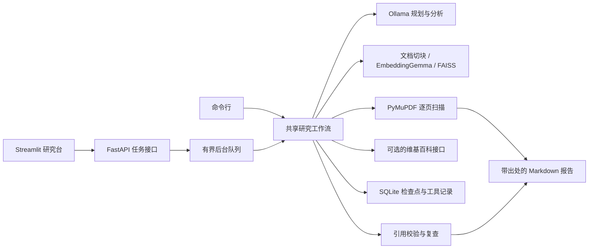

# Research Agent

**一个本地优先的技术研究助手。** 从研究问题或上传论文出发，拆解任务、收集证据、核对引用，最后生成带页码、行号或网页修订版本的 Markdown 报告。模型推理通过本机 Ollama 完成，命令行和 Streamlit 研究台共用同一套研究流程。

| 使用场景 | 系统行为 |
|---|---|
| 针对资料提问 | Ollama 生成任务计划，按依赖执行，结合本地检索与可选的维基百科资料。保留有证据支持的结论，在报告中列出证据缺口。 |
| 提取论文目录 | 对数字 PDF 逐页扫描，保留识别出的章节层级、页码范围与原文要点。 |
| 追踪和恢复任务 | 查看子任务、尝试次数、工具日志与历史报告，进程中断后可从 SQLite 检查点继续执行。 |

[本地报告样例](examples/reports/sqlite-local.md) · [联网报告样例](examples/reports/sqlite-web.md) · [应用与 API](docs/application.md) · [部署说明](docs/deployment.md)

## 架构



### 模型接口与工具执行

- `BaseLLM` 与 `OllamaLLM` 统一消息、流式响应、结构化输出、工具请求和 Token 统计。上层可以用测试替身复现超时、断流和无效响应。
- `ToolRegistry` 根据 JSON Schema 验证参数，分发已注册的工具，返回统一结果与错误码。计算器只接受允许的算术 AST 节点，文件读取限定在授权目录。
- 通用 Agent Loop 会将工具结果回传给模型，并在模型请求数、工具调用数或时间预算耗尽时停止。真实示例完成了「读文件 → 计算 → 返回 137」，共三轮模型调用。研究工作流由程序控制取证和校验，模型参与规划与分析。 [模型接口](src/research_agent/llm/base.py) · [工具注册表](src/research_agent/tools/registry.py) · [Agent Loop](src/research_agent/agent/engine.py)

### 计划、状态与故障恢复

模型输出结构化计划，程序校验任务依赖和优先级。执行失败时按预算重试，前置任务失败会阻塞依赖它的步骤。每次尝试先写检查点，中间结果和相关消息可在同一事务保存。同一研究任务由进程锁保护，恢复时跳过已经结束的步骤。项目用实际进程退出、再启动的方式验证了恢复流程。 [计划与调度](src/research_agent/agent/planning.py) · [执行器](src/research_agent/agent/executor.py) · [持久化与恢复测试](tests/test_memory.py)

### 文档证据与引用

普通问答用 PyMuPDF 解析数字 PDF，并支持 TXT、Markdown。切块保留物理页码或行号，EmbeddingGemma 生成向量，CPU FAISS 按相似度找候选。日志记录候选位置、分数和过滤后保留的数量。模型为每条结论选择原文摘录编号，程序回填引述及定位信息，再发起一次模型请求复查证据支持度。报告会标注证据缺口、被拒结论和单一来源。

「列出全部章节」这类目标需要检查全文覆盖。目录流程会遍历 PDF 页面，识别可见标题的层级与起止页，并从章节范围内挑选原文要点。这条路径可以在嵌入服务关闭时运行。 [文档处理](src/research_agent/rag/documents.py) · [目录提取](src/research_agent/research/outline.py) · [引用校验](src/research_agent/research/report.py)

### 应用边界

FastAPI 提供上传、提交、状态、历史、恢复和报告下载。Streamlit 的「沿用已上传资料」与「把上一轮问题作为背景」是独立选项。应用默认绑定本机环回地址，使用单工作线程和有界队列。上传文件、工具请求和模型响应都有大小或次数限制，外部资料无法授予工具权限。联网研究需要显式启用，目前提供方为英文维基百科。 [接口约定](docs/application.md) · [权限与预算](docs/security.md)

## 实际问题与改进

| 真实测试发现 | 改动 | 复测结果 |
|---|---|---|
| 第一篇 GCD 论文的 10 页都已解析，共 97 个片段，但目录子任务的三个候选全来自末尾参考文献。 | 增加逐页扫描的目录流程，按标题层级组织原文要点。 | 同一原始 PDF 识别出 16 个章节或文档部分，核对了 16 项标题及起始页，生成 9 个引用位置。 |
| 三条候选结论因引述无法在指定片段逐字找到而全部剔除。 | 将原文摘录预先编号，由程序根据模型选中的 ID 回填原文。 | 回归覆盖真实编号、未知编号及复查拒绝。普通问答的证据范围仍取决于检索召回。 |
| 复用论文时把上一轮的研究要求一并带进了新计划。 | 拆开复用资料与继承主题，并将旧主题作为可选背景。 | 用真实 PDF 做 API 回归，复用附件后只建立了本轮的目录扫描任务。 |
| 第二篇半监督 GMM 论文的 3.2 节标题跨行，算法框的 `13 end` 被识别为章节。 | 已用原页定位到标题续行和算法块编号两个边界。 | 当前仍有标题截断和一个假标题，影响 3.2 节的正文归属。这两项是后续目录解析的回归用例。 |

## 验证与工程数据

| 项目 | 实测 |
|---|---|
| 本地回归 | **72 项测试**，71 项通过，1 项因 Windows 文件符号链接创建权限跳过。 |
| 模型选择 | 在同一组小样本上，Qwen3.5 4B 与 0.8B 的工具任务分别通过 **6/6 与 2/6**，引用判定分别通过 **4/4 与 3/4**。默认使用 4B。 |
| 上下文优化 | 两个候选引用同一片段时，复查请求只发送一次共享证据。受控样例输入从 **422 降至 293 Token**，两版保留的结论一致。 |
| 部署与端到端 | 实测通过上传、任务状态、工具日志、报告与下载链路。已验证 wheel 在干净虚拟环境中的离线核心安装。 |

[评估报告及原始数据](docs/evaluation.md) · [测试目录](tests/) · [Windows CI 定义](.github/workflows/ci.yml)

## 在本机运行

需要 Windows PowerShell、Python 3.12 和 Ollama。在项目根目录安装依赖。

```powershell
py -3.12 -m venv .venv
.\.venv\Scripts\python.exe -m pip install -e '.[rag,app,test]'
.\.venv\Scripts\python.exe -m pip check
```

启动 Ollama 桌面应用，或在独立终端运行 `ollama serve`。默认聊天端口为 `11434`，在连接到该端口的终端运行 `ollama pull qwen3.5:4b`。随后在项目根目录的三个终端各运行一条启动命令。

```powershell
.\scripts\start-local.ps1 -Service embedding
.\scripts\start-local.ps1 -Service api
.\scripts\start-local.ps1 -Service ui
```

首次准备独立嵌入服务时，在另一终端设置 `$env:OLLAMA_HOST = '127.0.0.1:11435'`，然后运行 `ollama pull embeddinggemma`。打开 [研究台](http://127.0.0.1:8501)，上传 [SQLite WAL 示例](examples/research/sqlite-wal.md)，输入「说明 SQLite WAL 的检查点会做什么」。在任务历史查看索引和检索日志，以及报告中的文件行号和下载入口。API 文档位于 [本机 Swagger](http://127.0.0.1:8000/docs)。 [完整部署和端口配置](docs/deployment.md)

常用验收命令如下。单元测试可在 Ollama 离线时运行，`doctor`、`agent-demo` 和 `evaluate` 使用本机模型服务。

```powershell
.\.venv\Scripts\python.exe -X utf8 -B -m research_agent doctor
.\.venv\Scripts\python.exe -X utf8 -B -m research_agent agent-demo
.\.venv\Scripts\python.exe -X utf8 -B -m research_agent evaluate
.\.venv\Scripts\python.exe -X utf8 -B -m unittest discover -s tests -v
```

## 仓库结构

```text
src/research_agent/
  llm/          模型协议、适配和能力实测
  agent/        执行循环、任务规划与调度
  tools/        参数验证、工具权限与可插拔提供方
  rag/          按页解析、切块和向量检索
  research/     研究工作流、PDF 目录、证据与报告
  app/          FastAPI、Streamlit 和任务队列
  evaluation/  固定样例评估
  memory.py     SQLite 状态、消息和检查点
docs/           原始需求、架构、阶段验收和运维说明
examples/       可分享的输入、报告和实测数据
scripts/        Windows 启动器
tests/          单元、边界和 API 回归测试
```

## 当前适用范围

本项目面向本机单用户。数字 PDF 直接提取文字，扫描件需要先做 OCR。目录识别依赖 PDF 版面和文字层，复杂的多行标题、表格及算法编号仍需人工核对。引用复查辅助识别证据不足，报告保留原文位置供读者核查。

[需求与交付范围](docs/requirements.md) · [架构说明](docs/architecture.md) · [Phase 0–14 开发与验收](docs/roadmap.md) · [本地知识库](docs/retrieval.md) · [报告与历史](docs/research.md)
