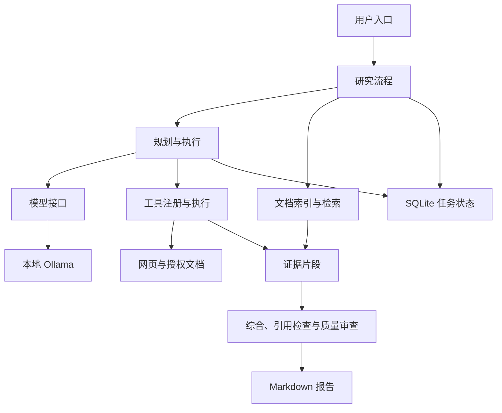

# 系统架构

## 模块与职责

| 模块 | 职责 |
|---|---|
| LLM | 定义统一消息、工具调用和响应类型。Ollama 适配层处理普通响应、流式响应、结构化输出和传输错误。 |
| Agent Core | 驱动模型决策和工具执行循环，实现任务拆解、依赖排序、失败重试、终止条件与预算检查。 |
| Tools | 注册和查询工具，提供参数模式，校验参数，执行工具并返回统一结果。提供计算器、文件读取、搜索、网页读取和文档解析能力。 |
| Memory | 管理当前对话与执行上下文，通过 SQLite 保存任务、步骤和历史，提供恢复所需的检查点。 |
| RAG | 加载和清洗文档、生成文本块和向量，检索相关片段，并保留片段的原文定位。 |
| Research Workflow | 将研究问题转换为计划，组织检索、阅读、综合与交叉验证，管理引用，生成并检查 Markdown 报告。 |
| Evaluation | 运行固定样例，记录任务与工具指标。结合执行事件定位失败步骤。 |
| Application | 通过 Streamlit 展示任务、资料和报告，通过 FastAPI 提供任务、历史和导出接口。两种入口共享同一研究流程。 |

## 执行与数据流



一次执行先记录研究目标和任务计划，再执行依赖已满足的子任务。工具结果保留来源、定位信息和执行状态，供模型继续决策。Agent 循环在完成、失败或达到预算时退出。研究流程使用已收集的证据生成报告，并检查引用编号、来源可定位性和证据覆盖情况。

## 关键数据约定

- **运行与子任务**。记录任务 ID、计划、前置依赖、优先级、状态和尝试次数。子任务完成时将结果与状态写入同一事务。恢复时读取最新检查点，对中断的步骤按工具的重试约定处理。
- **工具调用**。记录调用 ID、工具名、参数、结果或错误、耗时。Agent Core 通过注册表调用工具，应用入口通过执行事件展示进度。
- **来源与证据**。来源记录稳定 ID、标题、URL 或授权文件路径。证据引用来源 ID，并保存页码、段落号或文本块位置。报告由证据 ID 生成可读引用。
- **短期与长期记忆**。本轮所需的消息、计划和证据进入有限上下文。SQLite 保存可查询的历史与检查点，检索层从知识库取得可复用资料。

## 目标目录

下列目录随对应阶段建立。Phase 0 的实际目录见 [README](../README.md#目录)。

```text
src/research_agent/
├── llm/
├── agent/
├── tools/
├── memory/
├── rag/
├── research/
├── evaluation/
└── app/
tests/
examples/
docs/
```

Phase 1 建立 Python 包和运行入口。Phase 2 至 Phase 12 逐步实现核心模块，Phase 13 接入界面和 API。研究流程通过模型、工具和存储接口访问底层组件，便于替换搜索提供方、使用固定测试响应和复现实验。
